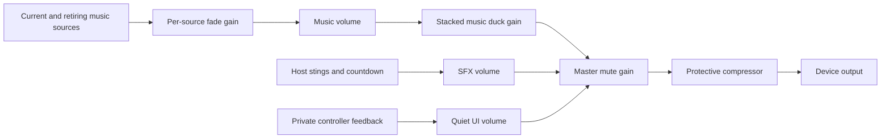

# Audio architecture

Phase 3.5 adds a presentation-only Web Audio system. The server continues to own phases, deadlines, scores and Event progression. Audio never advances a round, delays an input acknowledgement or grants room/workspace access. No database migration or new runtime dependency is needed.

## Boundaries

`shared/audio.ts` defines normalized `RoomView.audio`. Standalone Room emits the same semantic meanings as EventRuntime; the Event adapter keeps one launch-snapshot room identity across fresh per-segment engines. The contract contains stable room UUID, monotonic sequence, cue names, authoritative occurrence/phase timestamps, elapsed/remaining milliseconds, paused flag, stage, current profile and optional next-profile hint. It contains no filename, asset URL, private answer or customer audio configuration. Existing `RoomView.event.cue` stays compatible.

`AudioProvider` is lazy beneath the live host/player route boundary. Public pages, account settings, Studio and Event editors/previews do not create an AudioContext or fetch soundtrack bytes. Settings import only lightweight preference/form modules. PartyProvider exposes acknowledgement-based synchronization and a reconnect epoch so a broadcast received before resume acknowledgement cannot be mistaken for a new entrance.

The provider owns one shared engine per browser tab. It subscribes to normalized room snapshots, visibility and local input feedback. The engine delegates cue selection to CueRegistry/CueScheduler, music to MusicController, effects to SfxController, buffers to AudioPreloader and gains to AudioBus. Controllers do not know React, authentication or game scoring.

## Context and buses

There is one lazy AudioContext, not one per cue. Defaults are enabled, music 65%, effects 85%, with additional conservative internal bus scales (music ×0.65, effects ×0.7, phone UI ×0.24). The compressor uses threshold −4 dB, ratio 12, short attack/release; it is protective dynamics processing, not a loudness certification. Gain changes ramp over 35 ms. Each source/gain disconnects when finished. Music has at most one current and one retiring voice; each effect bus has at most six voices.

Trusted click/Enter/Space interactions call `resume()`. Listeners run after React control handlers so native checkbox changes survive unlocking. An already-running context is left alone. An explicit Enable/Retry action appears when locked, suspended or failed. No autoplay-policy bypass, audio permission prompt or credentialed browser storage token is introduced. See the [W3C Web Audio lifecycle/automation specification](https://www.w3.org/TR/webaudio/) and [Chrome autoplay guidance](https://developer.chrome.com/blog/web-audio-autoplay).

## Cue and timing policy

The exhaustive registry covers all 12 EventCue meanings. Stateful stage music is reconciled independently of one-shots. Entrance effects tolerate 400–700 ms according to cue; age uses `serverTime - occurredAt`, then adds local decode elapsed time. Duplicate sequence numbers are ignored for one-shots; older same-room snapshots cannot roll the music profile back. Co-occurring transitions select one highest-priority accent, keeping reveal/finale stronger than simultaneous lock/leaderboard accents. ANSWER_LOCKED means collection closes, not every player submit; reveal after creative voting does not emit it again.

A first snapshot, a new room, refresh, reconnect or return from background establishes a baseline and consumes the current sequence without replaying an entrance. A bounded 24-room sessionStorage cursor survives component remounts, with an in-memory fallback. A stable UUID prevents reused human room codes colliding. Reconnect restores the stateful loop at `(server phase elapsed + local elapsed since receipt) modulo loop duration`; authoritative elapsed excludes paused time. This is presentation alignment, not sample synchronization between machines, and does not estimate one-way network latency.

The host alone plays soundtrack, stings and countdown. Phones never instantiate music sources. Choice feedback is local; submit/vote feedback follows an existing successful server acknowledgement. Optional correct/incorrect feedback requires a submitted player, revealed correct-answer data and a scored Hotwire/Odd One In (including their scored Studio mode). Polls/scoreless/creative modes get no invented binary correctness. Feedback is throttled per kind (120 ms), confirmations delayed 70 ms to avoid colliding with a selection transient.

## Music, transitions and countdown

Stateful tracks cover lobby, intro, profile gameplay/voting, reveal/results, leaderboard, intermission and finale. Track changes crossfade for 360 ms with per-source linear gain ramps; the prior source is stopped and disconnected by the fade endpoint plus the existing 20 ms stop grace. Native ended handling and a matching cleanup deadline share idempotent disposal. Every allocated voice is owned before playback starts, and failed starts/retirements clean up before surfacing a retryable error. Rapid third requests finish the oldest retirement before starting another bed. Repeated snapshots never restart the same track. User mute fades/stops music while keeping SFX independent. Unmute resumes at the current phase offset.

Ducking has individually releasable requests; the strongest request wins, with 80 ms ramps. Reveal uses 0.22, finale 0.25, leaderboard 0.3 and start 0.4 multipliers. Requests expire after the effect plus 120 ms. Pause adds a 0.16 music multiplier and suppresses countdown; resume releases only the pause contribution. Loop playback quietly continues during pause instead of freezing the audio clock. Disconnect, route release and end cancel outstanding duck/timer state.

A 100 ms observer reads existing remaining time. It plays at most one tick per phase/remaining second, never schedules or changes gameplay deadlines, and checks again after asynchronous decoding. Hotwire/Odd One In/scored Studio warn at five seconds, urgent at three; creative profiles use three/two; Room Temperature and poll/scoreless Studio disable tension. Pause, muted SFX, hidden/disconnected tabs and stale phases suppress ticks. Background tabs dispose voices and suspend the context; foreground return reconciles music without replaying old effects. Event end fades the loop and releases the route engine after the short end accent.

## Preferences and controls

`ruckus-audio-v1:host:<accountId>` stores versioned, validated local preferences; capability-only tabs fall back to `host:device`. A sessionStorage hint remembers the last authenticated account for a host stage outside the app guard. It is a preference scope only. Logout clears the hint; no session/auth token is stored by audio. Player preferences use `player:device`, separate from host controls. Bad/blocked/full storage falls back to usable in-memory defaults. Volumes clamp to 0–1; unknown schema versions reset safely. Custom events synchronize controls within this tab. Other open tabs keep their current settings; saved defaults apply when they next load.

Host controls provide master mute, independent music/effects enable and styled volume sliders, plus the existing M shortcut. Account settings expose the same preferences. The phone gets a small sound toggle. Native labeled controls preserve keyboard and focus behavior; numeric volume text accompanies sliders. All essential countdown, pause, submission, reveal, scores and progression remain visual. Reduced-motion behavior stays with existing visual CSS; audio adds no animation requirement.

Multiple host tabs/devices remain independent output devices; there is no cross-device election or BroadcastChannel coordination. The host control says “this tab”; mute spare stage tabs to avoid duplicate physical output. Player music is prohibited by role regardless of preference.

## Delivery, memory and failure

Static content-hashed Opus-in-Ogg primary and MP3 fallback files live in `public/audio`. Compiled `/audio` responses are immutable for one year; browsers fetch trusted same-origin catalog paths with strict MIME/size checks, no redirects or user-supplied URLs. Source code imports compact metadata only, never audio bytes. Production already sets nosniff. No cookies/tokens are added to URLs or logged.

Warmup fetches current stage, relevant transition effects, current game and at most the next game, using two workers. Phone warmup is only selection/confirmation/vote. Compressed promises have a 16-entry LRU, decoded buffers an eight-entry LRU, pending jobs deduplicate, and clear aborts in-flight work with generation checks against late completion. Active sources may hold evicted buffers until their short retirement completes. Eight maximum-duration 48 kHz stereo float buffers are roughly 60 MB; typical active cache is smaller. There is no fetch/decode per render and no loading all profiles at launch.

Decode/network failure tries MP3, then the neutral Studio bed for failed music, then silence. Failed IDs back off 30 seconds and log a bounded asset identifier once, never a URL with secrets. Unsupported contexts show an actionable quiet status. Neither missing assets nor failed contexts block game controls. Module/route cleanup stops sources, clears caches/timers and retains only the one reusable context until tab teardown. Diagnostics expose non-sensitive state/counts as DOM data attributes for tests; no visible production debug console is shipped.

See [sonic design](SONIC-DESIGN.md), [provenance](../audio/ASSET-PROVENANCE.md) and [validation report](PHASE-3-5-REPORT.md). Assets are original pre-release references pending human audible approval.

The [Phase 3.5 overlap hotfix](PHASE-3-5-AUDIO-HOTFIX.md) documents the ownership failure, pending-load invalidation, native source-count regressions and listening limitations.
