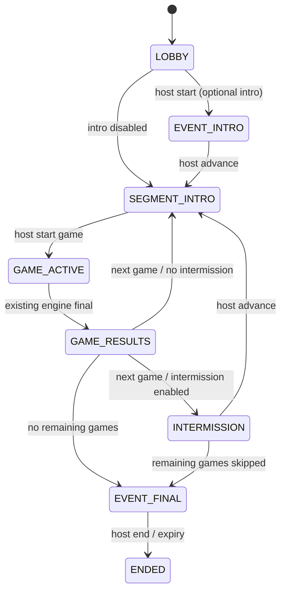

# Event runtime

`server/events/runtime.ts` is a thin parent around the existing `Room`. A segment gets a fresh engine instance with the same player/token Map, host socket and room code/join URL. The parent's original host capability remains authoritative. Game scores/statistics reset per segment; separate event points persist. Old engine timers and bot jobs are disposed before moving on. A failed upcoming initializer retains the prior audience/state and reports a safe host-only message/correlation ID. Hosts can retry Continue, skip the failed upcoming item or end; guests keep a waiting screen. Event segments and new standalone rooms receive frozen Original prompts before runtime; direct engine fixtures retain the canonical lookup fallback.

The authoritative lifecycle is:

The host can end from any state. Skip-next is allowed only between segments, and always targets a future item. It never silently discards an active game. A typed event command carries expected lifecycle sequence; ordinary host commands in Event rooms carry the expected round key. Duplicate/stale progression fails safely. Gameplay still uses existing timed collection/voting, manual reveals, pause/resume, moderation and bots. No six-engine rewrite or generic workflow system exists.

Players join once through the ordinary five-character code or QR. Original player IDs, names, avatars, capabilities and connections persist across all segments. Reconnect returns full current state, current event points and cue; no transition history is replayed. Segment-qualified round keys reject old controller inputs. A late join starts with zero event points and becomes eligible through the existing round boundary. Disconnected players keep earned points. Removed players lose room access. Late joins can be disabled without disabling reconnect.

## Event scoring

Raw scores are not comparable: Hotwire awards 500–1,000 by speed, Room Temperature 600 for the majority, Odd One In 700, and creative games 300 per vote. Studio also supports casual/speed/no-score/polls. The in-game algorithms and game leaderboards remain unchanged.

Each completed scored segment awards `round(1000 * (n - 1 - numberOfPlayersWithHigherScore) / (n - 1))` to participants, where n is the number eligible in at least one round of that segment. A sole participant earns 1,000 when they have a positive score. Equal scores share placement/points; top ties earn 1,000. When every raw score is zero, everyone earns zero. UUID orders equal totals for display only, and displayed ranks remain tied. A wholly scoreless Studio board awards no event points. Disconnected eligible players remain included; a guest who arrives after the last round earns no fabricated participation. Event points are accumulated once at game final.

`carryScoresAcrossGames=false` disables accumulation and event leaderboard presentation. `showFinalEventLeaderboard=false` hides only the final aggregate display; existing event totals remain available in runtime state. Game result screens still show the game's own scores. Live Event state is not restored after a server restart. Phase 5 preserves acknowledged finalized totals in Session History without reviving the room.

## Semantic audio cues

`RoomView.event.cue` includes typed `name`, the semantic `names` belonging to the same transition, a monotonic cue sequence and authoritative millisecond timestamp. `RoomView.event.sequence` identifies the current lifecycle/phase version. Clients compare cue sequence when observing current state; reconnect must establish the current baseline without replaying it.

Supported meanings: LOBBY_ENTER, EVENT_START, EVENT_INTRO_ENTER, SEGMENT_INTRO_ENTER, QUESTION_OPEN, ANSWER_LOCKED (the collection phase closing), REVEAL_ENTER, GAME_RESULTS_ENTER, EVENT_LEADERBOARD_ENTER, INTERMISSION_ENTER, FINAL_RESULTS_ENTER and EVENT_END. Simultaneous meanings share a timestamp. Creative voting emits ANSWER_LOCKED once when collection closes; its later reveal emits REVEAL_ENTER without repeating the lock. Individual phone feedback uses existing input acknowledgements, never these room-wide cues.

Phase 3.5 normalizes `RoomView.audio` for both standalone and Event rooms. The Event launch UUID stays stable across segment engines, while cue sequence/timestamps follow the parent. Stage mapping chooses lobby/intro/profile gameplay/results/leaderboard/intermission/finale beds in the browser registry. Pause/remaining/elapsed timing comes from the existing engine. Reconnect acknowledgement establishes a baseline, restores the current loop at a phase offset and never replays the current entrance sting. Audio cannot progress the Event, alter scores or block inputs. [Audio architecture](AUDIO-ARCHITECTURE.md) defines loading, crossfades, ducking, countdown and host/phone separation. Current assets are an original pre-release reference pack pending human audible QA.

## Runtime and persistence limits

Event definitions/revisions and launch snapshots/images persist in PostgreSQL. Room membership, answers, segment state and points remain in memory. Phase 3 deliberately omitted durable Event results. Phase 5 now uses that launch snapshot UUID as the session_runs identity without implying resumable live rooms. `event.ended` remains a best-effort append-only operational record on completion or host/server end; Phase 5 results have a separate transactional finalizer. Failed end-audit writes log a sanitized operational category; that separate best-effort event.ended record has no retry guarantee. Session results and their own completion audit use the Phase 6 durable outbox. Hostless rooms end under existing five-minute cleanup; inactive/ended rooms are removed under existing retention timers. Brand image delivery follows that live-room availability.

## Phase 5 completion hooks

Before replacing an inner Room, retain its bounded outcome counters and original segment index. At EVENT_FINAL/ENDED, historySummary freezes actual played segments, source revisions and final placement standings. It does not rebuild points from historical game rules. Duplicate callbacks reuse the captured summary; the socket adapter attempts its run only once and the PostgreSQL writer independently enforces idempotency. Capturing incomplete first rounds yields no history. No raw submissions, private host notes, launch document or guest image bytes enter the summary. See [Session History](SESSION-HISTORY.md).

## Phase 6 operation

Drain rejects new launches but permits existing audience joins/reconnect/play. Shutdown rejects further mutations before disposal, captures qualified early-end summaries and waits for bounded durable enqueue/in-flight work; a process deadline cannot restore live Event state. Queued outcomes recover independently of a room/code. A second worker completing history is reconciled back to the originating host by bounded terminal-only observation. Source snapshots and Event scoring/timing/audio remain unchanged. See [Reliability](RELIABILITY.md).
